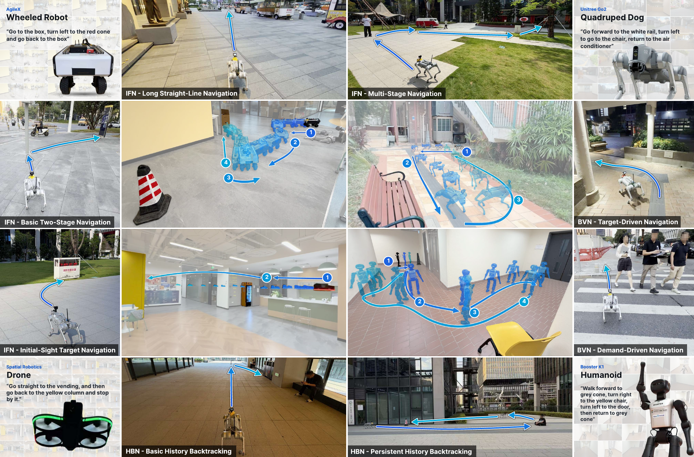
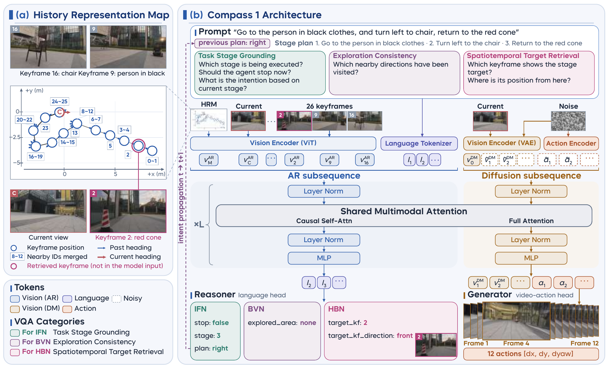

<p align="center">
  
</p>

<h1 align="center"><strong>Compass 1: Towards Open-World and Persistent Embodied Navigation from Monocular RGB Videos</strong></h1>

<div id="top" align="center">

<div>
  <a href="https://www.archon.tech/research/compass1"></a>
  <a href="https://arxiv.org/abs/2611.12087"></a>
  <a href="LICENSE"></a>
</div>

</div>

## 📖 Introduction

<p align="center">
  
</p>

We present **Compass 1**, the first embodied navigation foundation model to unify language understanding and video generation while enabling memory backtracking through nearly **two minutes** of visual history. Compass 1 achieves a dominant overall success rate of **79.4%** across open-world evaluations, compared to **17.8%** for the strongest baseline.

**Developers**: [Hai Zhang](https://betray12138.github.io/resume/) and [Siqi Liang](https://github.com/stdcat)

## 📢 News

- 🎉 **2026-11-10**: The [project page](https://www.archon.tech/research/compass1) is now available!
- 🎉 **2026-11-10**: The [arXiv preprint](https://arxiv.org/abs/2611.12087) is now available!
- 🚀 **2026-12 (Expected)**: Compass 1 dataset release.
- 🚀 **2026-12 (Expected)**: Compass 1 deployment code & real-world model checkpoint release.

## 📌 Table of Contents

- 📖 [Introduction](#-introduction)
- 📢 [News](#-news)
- 🔥 [Highlights](#-highlights)
- 📝 [TODO List](#-todo-list)
- 📬 [Contact](#-contact)
- 📄 [License and Citation](#-license-and-citation)

## 🔥 Highlights

- **Keyframe-Level Unified Backbone & History Representation Map:** To our knowledge, we present the first keyframe-level foundation model built on a unified backbone for embodied navigation.
- **Structured VQA Supervision Protocol:** Three structured VQA categories are designed to fully utilize the history reasoning capability and resolve physical execution failure modes.
- **Cost-Effective Data Annotation Pipeline:** A massive navigation corpus featuring over 500 hours of real-world interactions and over 2,000 hours of annotated web videos.
- **Thorough Physical Evaluation & Zero-Shot Cross-Embodiment Generalization:** Compass 1 drastically outperforms strong baselines across all physical navigation tasks.

<p align="center">
  
</p>


## 📝 TODO List

- [x] Compass 1 Paper Release.
  - [x] arXiv preprint is now available!
  - [x] Project page and navigation demos are now available!
- [ ] Compass 1 Dataset Release (Expected December 2026).
  - [ ] Release the dataset with download instructions.
- [ ] Compass 1 Deployment Code & Real-World Model Checkpoint Release (Expected December 2026).
  - [ ] Release deployment code with installation instructions and usage examples.
  - [ ] Publish real-world model checkpoints and download instructions.

## 📬 Contact

For further inquiries or assistance, please contact [zhanghenryhai12138@gmail.com](mailto:zhanghenryhai12138@gmail.com) or [liangsiqi@connect.hku.hk](mailto:liangsiqi@connect.hku.hk).

## 📄 License and Citation

This repository is licensed under the [Apache-2.0 license](LICENSE).

- Please consider citing our work if it helps your research.

```bibtex
@article{archon2026compass1,
  title={Compass 1: Towards Open-World and Persistent Embodied Navigation from Monocular RGB Videos},
  author={Zhang, Hai and Liang, Siqi and Guo, Yanjun and Zhang, Shoufeng and Wang, Yunhao and Du, Hangyu and Mai, Haoguang and Li, Hongchen and Yang, Jiazhi and Zeng, Jialong and Hu, Yu and Chen, Chen and Jiang, Gangcheng and Zhuo, Zishun and Zhao, Lirui and Li, Zhigang and Qiao, Yu and Yang, Zhenjie and Zhang, Fu and Li, Hongyang},
  journal={arXiv preprint arXiv:2611.12087},
  year={2026},
  eprint={2611.12087},
  archivePrefix={arXiv},
  primaryClass={cs.CV},
  url={https://arxiv.org/abs/2611.12087}
}

@inproceedings{zhang2026sparse,
  title={Sparse Video Generation Propels Real-World Beyond-the-View Vision-Language Navigation},
  author={Zhang, Hai and Liang, Siqi and Chen, Li and Li, Yuxian and Xu, Yukuan and Zhong, Yichao and Zhang, Fu and Li, Hongyang},
  booktitle={NeurIPS},
  year={2026},
}
```
